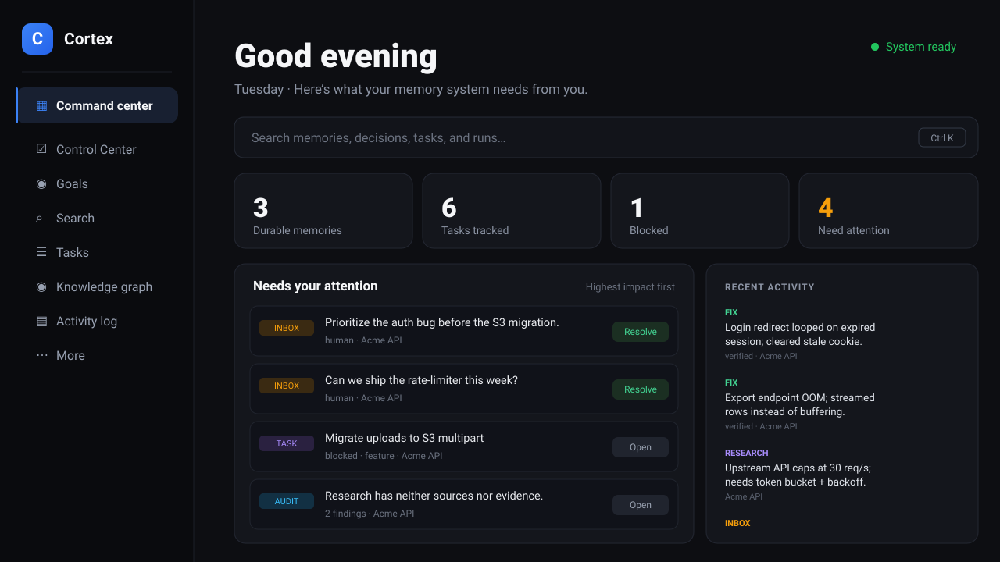
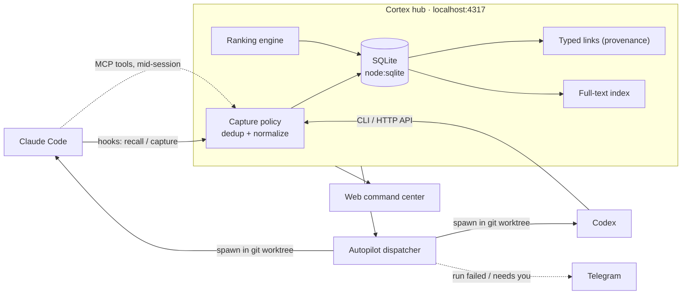
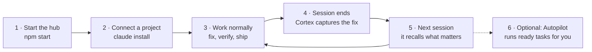
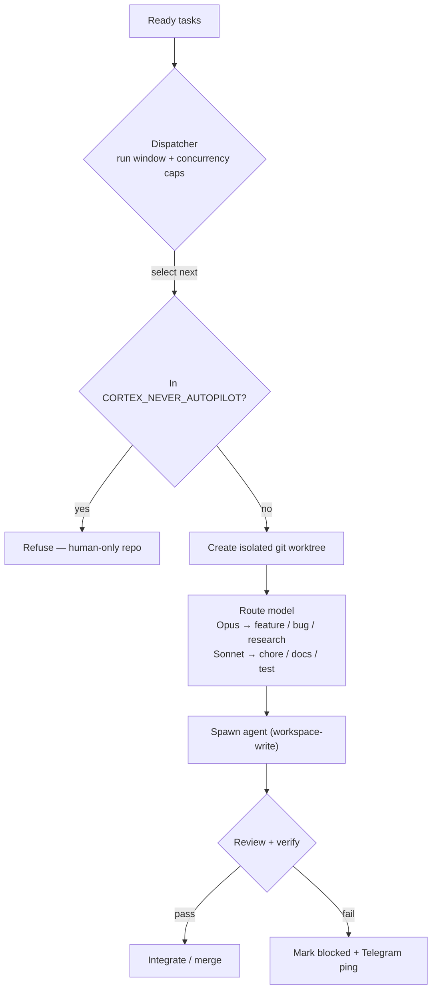

# Cortex

**A local memory and autopilot layer for coding agents.**


Coding agents forget everything the moment a session ends. Cortex gives them a
memory that persists — and, if you want it, a way to keep working while you sleep.

It runs entirely on your machine: one Node process, one SQLite file, no external
services, no data leaving your laptop. It works with **Claude Code** and **Codex**
out of the box.



> Your agent → the Cortex hub on `localhost:4317` → a memory that gets smarter
> every session, a command center, and an optional autopilot.

**Contents:** [What it does](#what-it-does) · [How it works](#how-it-works) ·
[The memory lifecycle](#the-memory-lifecycle) · [Quickstart](#quickstart) ·
[Connect your agent](#connect-your-agent) · [Using the system](#using-the-system) ·
[The dashboard](#the-dashboard) · [Autopilot](#autopilot) · [CLI reference](#cli-reference) ·
[Deploy](#deploy-with-docker) · [Security](#security-model)

---

## What it does

**🧠 Memory that survives sessions.** As your agent finishes work, Cortex quietly
captures the things worth keeping — a fix and how it was verified, a research
finding, a blocker, a task that changed state. Generic "done!" chatter is thrown
away. What's left is deduplicated, linked to related records with typed
provenance, and ranked so the next session recalls the *relevant* past, not all
of it — packed to fit a token budget you control.

**🎛️ A command center.** A dark web dashboard that puts blocked work, unresolved
questions, and recent activity first. Search across projects with explained
scores, inspect the token pack, browse tasks and agent runs, run a database
audit, and explore an interactive graph of how your records connect.

**🤖 Autopilot (optional).** Enroll a project and Cortex can pick up its ready
tasks and run them autonomously — each in an isolated git worktree, with the
right model for the job (heavier reasoning for features and bugs, cheaper models
for chores), automatic review and verification, and a Telegram ping when
something needs you or a run fails. A hard safety guard refuses to ever launch an
agent against repos you mark off-limits.

---

## How it works

Cortex is a single local process. Your agents talk to it three ways — session
hooks, an MCP server for mid-session calls, and a plain HTTP/CLI interface — and
everything lands in one SQLite database that the dashboard and Autopilot both read.



**No external dependencies for storage or search.** The database is Node's
built-in `node:sqlite` (that's why it needs Node ≥ 25) and search is a
deterministic local ranker — no vector database, no embedding API, no keys.

---

## The memory lifecycle

Every session is a loop: recall relevant context at the start, capture durable
takeaways at the end. The signal survives; the chatter doesn't.

```mermaid
sequenceDiagram
    participant A as Agent
    participant H as Cortex hook
    participant P as Capture policy
    participant DB as SQLite

    rect rgb(30,40,55)
    Note over A,DB: Session start
    A->>H: SessionStart
    H->>DB: recall ranked context (token-budgeted)
    DB-->>A: compact project brief
    end

    Note over A,DB: ...work happens...

    rect rgb(45,35,50)
    Note over A,DB: Session stop
    A->>H: Stop (full transcript)
    H->>P: any durable takeaways?
    P->>P: discard chatter · dedup · normalize
    P->>DB: store fix / research / blocker / task change
    DB->>DB: link to related records + index
    end
```



### What gets captured

| Record type | Example | Kept because |
|---|---|---|
| **Fix** | "Login redirect looped; fixed by clearing stale cookie. Verified: `npm test`." | Durable, verifiable |
| **Research** | "Vendor API rate-limits at 30 req/s; backoff needed." | Reusable finding |
| **Blocker** | "Deploy blocked: missing prod DB migration." | Unblocks future work |
| **Decision** | "Chose SQLite over Postgres — single-user, local-first." | Explains the "why" |
| **Task change** | task moved `ready → blocked → done` | Progress you can query |
| **Lesson** | a pattern promoted after recurring across sessions | Hard-won knowledge |

Generic completion chatter ("Done!", "Let me know if you need anything else") is
discarded before it ever reaches the database.

### How recall ranks results

Search needs no API key. Its deterministic score blends four signals, so a
*verified* older fix can still outrank recent noise:

```text
score  =  lexical relevance          (does the text match?)
        + typed graph proximity       (is it linked to what you're touching?)
        + record quality              (verified > unverified, fix > chatter)
        + recency decay               (newer counts more, but doesn't win alone)
        ─────────────────────────────
        then packed to fit your token budget
```

---

## Quickstart

Requires **Node.js ≥ 25** (Cortex uses the built-in `node:sqlite` module — no
native build step, no database to install).

```bash
git clone https://github.com/gsl0001/Cortex.git cortex
cd cortex
npm install

# Set a write token (any long random string). Writes are refused until this exists.
export CORTEX_TOKEN="$(openssl rand -hex 24)"   # Windows: setx CORTEX_TOKEN "..." then open a new terminal

npm run web:build
npm start
```

Open **http://127.0.0.1:4317**. The server binds to loopback only and indexes
your records on startup.

---

## Connect your agent

### Claude Code

Install the hooks into any project you want remembered:

```bash
node src/cli.js claude install --project /path/to/your/project
```

From then on, Claude recalls compact project context at the start of a session
and Cortex captures durable takeaways when it stops — automatically.

### Mid-session recall (MCP)

Hooks cover session boundaries. To let an agent search or save memory *during* a
session, start the server (`npm start`) and register the MCP server in the
project's `.mcp.json`:

```json
{
  "mcpServers": {
    "cortex": {
      "command": "node",
      "args": ["/absolute/path/to/cortex/src/mcp.js"],
      "env": {
        "CORTEX_URL": "http://127.0.0.1:4317",
        "CORTEX_TOKEN": "${CORTEX_TOKEN}",
        "CORTEX_AGENT": "claude-code"
      }
    }
  }
}
```

Use the **absolute path** to `src/mcp.js` in your Cortex checkout — your agent
launches this from your project's directory, not Cortex's.

Five tools are exposed: `memory_search`, `memory_remember`, `memory_recall_task`,
`memory_update_task`, `memory_lesson`.

Codex uses the same CLI and HTTP API.

---

## Using the system

A typical end-to-end flow, from zero to a self-improving memory:



1. **Start the hub** once — it stays running and serves the dashboard at
   `localhost:4317`.
2. **Connect a project:** `node src/cli.js claude install --project ~/code/myapp`.
   Now every Claude Code session in that repo recalls context on start and
   captures durable takeaways on stop.
3. **Work normally.** Fix a bug and verify it. You don't do anything special —
   Cortex watches the session boundaries.
4. **The session ends** and Cortex stores the fix plus how it was verified,
   throwing away the surrounding chatter.
5. **Next session, it remembers.** Your agent opens with a brief: recent fixes,
   open blockers, and relevant research — ranked and trimmed to a token budget.
6. **Search or track work anytime** — from the dashboard or the CLI:

```bash
# "How did we solve this before?"
node src/cli.js search --project ~/code/myapp --query "auth redirect loop"

# See the current project brief the agent would receive
node src/cli.js brief --project ~/code/myapp

# Capture a task, then let a human or agent pick it up
node src/cli.js task add --project ~/code/myapp --title "Rate-limit the export endpoint" --type chore --priority high
node src/cli.js next-task --project ~/code/myapp --claim --agent claude-code
```

7. **(Optional) Turn on Autopilot** for a project from the dashboard's Control
   Center — Cortex will run its ready tasks in isolated worktrees and ping you on
   Telegram when a run finishes or needs you. See [Autopilot](#autopilot).

---

## The dashboard

The web command center (dark, keyboard-friendly) is organized around *what needs
attention first*:

| Area | What it shows |
|---|---|
| **Command Center** | Blocked work, unresolved inbox questions, and recent activity — the "what's on fire" view |
| **Search** | Project-scoped search with **explained scores** and the exact token pack an agent would receive |
| **Tasks** | Every task with type, priority, status, and its full history |
| **Runs** | Autopilot agent runs, live status, and raw run logs |
| **Goals / Roadmap** | Milestones, weekly plans, and roadmap proposals |
| **Graph** | An interactive graph of records and their typed links — manual links are saved with full confidence, inferred ones keep their own provenance |
| **Audit** | A read-only database health check you can run any time |
| **Control Center** | Enroll/pause projects for Autopilot, set concurrency and run windows |

---

## Autopilot

Autopilot turns a backlog of ready tasks into finished, reviewed work — safely.
Each task runs in a throwaway git worktree (never your working checkout), with the
model matched to the task type, and every result is reviewed and verified before
it can complete.



**Safety guard.** Set `CORTEX_NEVER_AUTOPILOT` to a comma-separated list of
absolute paths that an agent must never be launched against (production repos,
anything that moves money). The guard fires at the launch chokepoint itself, so
both the dispatcher and a direct launch request are blocked. See
[SETUP.md](SETUP.md#7-autopilot) for enrollment and tuning.

---

## CLI reference

Run `node src/cli.js` with no arguments for the full, always-current list.

| Group | Commands |
|---|---|
| **Search & recall** | `search`, `brief`, `stats`, `index rebuild` |
| **Tasks** | `task add`, `task claim`, `task block`, `task done`, `next-task` |
| **Capture** | `fix add`, `research add`, `session start`, `session finish` |
| **Inbox** | `inbox add`, `inbox list`, `inbox resolve` |
| **Planning** | `roadmap proposal-add`, `roadmap show`, `goals`, `week show`, `week auto-plan` |
| **Agent hooks** | `claude install`, `claude recall`, `claude flush` |
| **Maintenance** | `audit --all`, `maintenance sweep` |

```bash
node src/cli.js search --project . --query "close fill" --max-tokens 1500
node src/cli.js task add --project . --title "Fix login redirect" --type bug --priority high
node src/cli.js audit --all --json
```

---

## Deploy with Docker

```bash
docker build -t cortex .
docker run -d \
  -e CORTEX_TOKEN="your-long-random-token" \
  -p 4317:4317 \
  -v cortex-data:/data \
  cortex
```

The image builds the web UI, binds `0.0.0.0` (so port-mapping works), and stores
the database on the `/data` volume. Because it binds beyond loopback, the server
**requires** `CORTEX_TOKEN` and refuses to start without it. Put it behind a
reverse proxy with TLS if you expose it beyond localhost.

---

## Configuration

Only `CORTEX_TOKEN` is required. Everything else has a sensible default — see
[`.env.example`](.env.example) for the common knobs (`CORTEX_DB`, `CORTEX_HOST`,
`CORTEX_PORT`, `CORTEX_NEVER_AUTOPILOT`) and [`SETUP.md`](SETUP.md) for the full
setup, agent adapters, and Autopilot details.

## Security model

- **Loopback by default.** The server only binds a public interface when you opt
  in (`CORTEX_ALLOW_REMOTE=1`), and even then refuses to start without a token.
- **Writes are default-deny.** Every `POST`/`PATCH`/`DELETE` is rejected until
  `CORTEX_TOKEN` is set — even on localhost.
- **Reads are gated off-loopback.** When bound beyond loopback, read endpoints
  require the token too — not just writes.
- **Autopilot is fenced.** Agents run in throwaway git worktrees, never your main
  checkout, and repos listed in `CORTEX_NEVER_AUTOPILOT` can never be launched.
- **Treat `CORTEX_TOKEN` like an SSH key.** Autopilot spawns coding agents and runs
  task verification commands automatically, so a leaked token means code execution
  on the host, not just read access. Keep the hub on loopback unless you front it
  with an authenticating reverse proxy over TLS.

## Development

```bash
npm test            # backend suite (node:test) — 335 tests
npm run web:test    # web UI tests (vitest) — 51 tests
npm run web:build   # production build
```

## Back up

Stop the server, copy the SQLite file, restart, and rebuild the index:

```bash
cp ~/.cortex/cortex.sqlite ~/.cortex/cortex.backup.sqlite
node src/cli.js index rebuild
```

## License

MIT — see [LICENSE](LICENSE).
